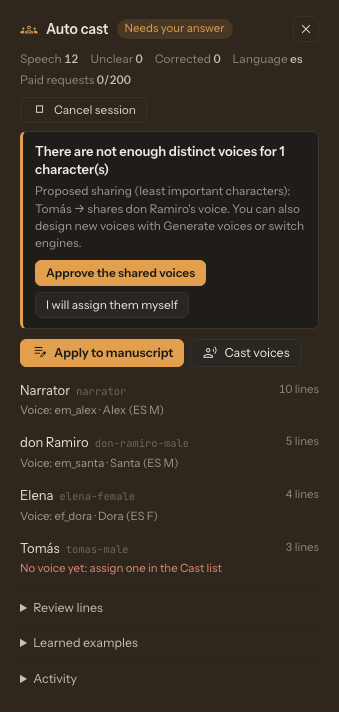

# Auto Cast a Story

**Auto cast** turns an untagged story into a multi-voice production. The configured LLM decides who says each line, asks you when it is unsure, and a different voice is chosen for every character. It uses the same LLM chain as Prep text: LM Studio or Ollama locally, or Gemini, Atlas Cloud and OpenRouter in the cloud, including backup profiles.

Unlike Prep text, Auto cast **never rewrites the story**. TTS-Story splits the text into passages itself (dialogue, narration, headings and direction tags), and the model only labels the speaker of each speech passage. The tagged manuscript is rebuilt from your original text and checked character by character before it is used.

*The Auto cast panel shows progress, open questions and the voice chosen for each character.*

## Start Auto cast

1. Open [Generate](app:generate) and load or paste the story without speaker tags.
2. Click **Auto cast** in the Manuscript header.
3. Keep working while the **Auto cast** panel at the top of the right column shows progress.

If the manuscript already has speaker tags, TTS-Story asks before identifying the speakers again. Existing direction tags are kept.

Dialogue is recognized in the usual forms: quotation marks (“…”, «…», "…", ‘…’) and Spanish-style dialogue dashes, including narrator interruptions such as `—Vamos —dijo Juan— que es tarde.` Thoughts, letters and songs are attributed to the character who thinks, writes or sings them.

## Answer the questions

The model does not guess silently. Questions appear in the panel, and the **Auto cast** button shows a dot while any are waiting:

- **Unclear lines** — let the narrator read them, or choose the speaker of each one.
- **First-person stories** — when the narration uses "I", it is read with that character's voice. If the narrator is unclear, you are asked who it is.
- **Possible duplicates** — confirm whether two names (for example a nickname and a full name) are the same character.
- **Shared voices** — a voice is shared only when the engine has too few voices, and only after you approve it.

Audio generation stays blocked while questions are open.

## Correct lines and teach the model

Open **Review lines** to see unclear lines (or all speech) and change a speaker. Each correction becomes a **learned example**. Auto cast then offers to re-check similar nearby lines with your example; the model proposes changes and you accept or reject each one. Lines you corrected are never changed again.

Under **Learned examples**, turn an example off to stop using it for future checks. The corrected line keeps the speaker you chose.

## Apply and cast voices

1. Click **Apply to manuscript**. The editor receives the tagged story (one ASCII tag per character, such as `jose-male` for José) and the Cast list refreshes.
2. Choose the engine in **Output** and make sure its voices are loaded.
3. Click **Cast voices**. Voices are ranked for each character using gender, language and the character description, and the most important characters are cast first.
4. Review the Cast list and use **Quick test** as usual. Any voice can be changed manually.

Voices whose language does not match the story are skipped; if the engine has none in the story language, you are asked before using the whole catalog. Engines that publish little voice information (for example OpenAI) give the model less to work with, so review those choices carefully.

When an Auto cast manuscript is generated, every speaker must have its own assignment. A speaker without one stops the job instead of silently borrowing another speaker's voice.

## Paid request limit

Each session counts requests sent to pay-per-use API providers. When the limit is reached, Auto cast pauses and asks whether to raise the limit, remove it, continue with local models only, or stop. Local models (LM Studio, Ollama) are never counted. Set the default under [Settings](app:settings) → **Text prep (LLM)** → **Auto cast paid-request limit** (`0` means no limit).

## Sessions

Sessions are stored on the TTS-Story server and saved with the Project. **Pause** stops after the current request; **Resume** continues where it stopped, including after a restart of TTS-Story. **Cancel session** closes the assistant without touching the manuscript or voices already applied. Each session keeps a copy of the story; deleting a Project also deletes its Auto cast sessions.

Cloud providers receive the story text for the requests they serve. Use a local provider when the story must stay on this computer. See [LM Studio and Ollama](help:llm-local).
