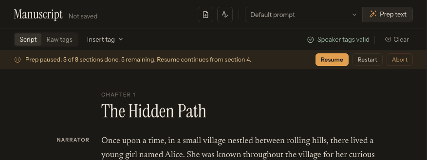

# Prepare Text with an LLM

**Prep text** (in the Manuscript header) sends the current manuscript through the LLM provider configured under **Settings → Text prep (LLM)**. It can clean punctuation, normalize text for speech, add speaker tags, and help create speaker-profile information.

This step is optional. TTS-Story can synthesize text without an LLM.

## Protect the source first

> **Critical:** When preparation completes, its combined result replaces the entire manuscript. There is no built-in side-by-side review or one-click undo.

Before clicking **Prep text**:

1. Keep the original manuscript in a separate file.
2. Save the current Generate-page state in **Projects** (the Project switcher at the top of the left sidebar) if useful.
3. For important work, copy the current manuscript to a versioned external document as well; projects are not portable backups.

Loading a saved project later also replaces the current manuscript, so name snapshots clearly.

## Configure the provider

Open [Settings](app:settings), choose **Text prep (LLM)** in the section list, and select one of these as **Primary provider**:

- Gemini
- Atlas Cloud
- OpenRouter
- Local LM Studio or Ollama

For a cloud provider, enter the API key and fetch the available models. For a local provider, start its server, enter the correct base URL, and fetch local models. Click **Save settings**.

See [LLM Preparation Overview](help:llm-overview), [Gemini, Atlas Cloud, and OpenRouter](help:llm-cloud), or [LM Studio and Ollama](help:llm-local).

## Choose the prompt intentionally

On [Generate](app:generate), use the prompt selector beside **Prep text** in the Manuscript header:

- **Default prompt** applies the saved default instructions.
- A named preset applies that preset's prompt.

The prompt determines how aggressively the model edits. If exact wording matters, explicitly require preservation of all prose, dialogue, names, paragraph order, and chapter headings. Avoid asking for broad “improvement” unless rewriting is acceptable.

When preparing a project for Breeze TTS 2 Voice Direction, add a focused instruction such as: “Where a meaningful performance change is needed, insert one concise `[direction]...[/direction]` immediately before the affected speaker block. Describe only audible delivery—tone, pace, volume, emphasis, and emotion. Do not rewrite the spoken text, and do not add directions to ordinary passages.” Review every generated direction before synthesis.

Read [Prompt Presets, Chunking, and Review](help:llm-prompts) before processing a full book.

## What happens during preparation

1. TTS-Story builds a section list using the enabled section-heading terms.
2. It processes the sections in sequence and carries forward known speaker names.
3. The progress display reports the current section.
4. High-demand, overloaded, timeout, connection, and temporary service failures retry the current LLM profile up to five times. Explicit quota exhaustion or the profile's local daily request cap advances to the next backup immediately. Authentication and validation failures stop so you can correct the setting.
5. **Pause** requests a stop after the current section and preserves progress.
6. **Resume** continues saved progress; **Restart** clears the saved sections and begins again from section 1; **Abort** discards the saved preparation progress.
7. After every section succeeds, the outputs are combined and replace the manuscript.
8. TTS-Story automatically analyzes the new text and can request speaker profiles.

If profile generation fails or a provider omits one or more speakers, use **Build profiles** below the **Cast** list. This retries profile and voice-type analysis for all detected speakers using the text already in the editor; it does not rerun Prep text or rewrite the manuscript.

*A paused or interrupted preparation preserves completed sections and offers distinct Resume, Restart, and Abort actions.*

Saved preparation progress is tied to the text being processed. Changing the source can make an older resume state inappropriate.

## Strict Book Conversion V3 - Directed

Choose **Strict Book Conversion V3 - Directed** to keep a stable vocal identity separate from delivery. V2 remains available unchanged, alongside a dated backup. V3 retains the source-preservation, matched-tag, speaker-identity, narrator-restraint, and existing pause-control rules.

The profile-building stage assigns a concise **Voice type**, such as `High-pitched, squeaky, comically pompous.` Review it in the speaker's **Edit speaker** drawer (**Character** section, **Voice type** field). Voice type describes pitch, timbre, and characteristic manner without gender/age labels or momentary emotions. The separate **Voice design prompt** (under **Advanced** in **Design a new voice**) incorporates this identity with the gender/age information needed to create the reference sample.

The manuscript still contains only passage delivery, for example `[direction]Spoken with self-important confidence.[/direction]`. Local Breeze and Breeze API automatically prepend the saved Voice type when synthesizing; do not repeat it in the manuscript. Other engines retain their existing behavior. Using the same reference sample and the existing local per-speaker seed helps consistency, but does not guarantee identical voice quality across different passages; this feature does not add seed control to the hosted API.

New jobs save speaker properties with their voice assignments and chunks. In Library, click **Review chunks** on a chapter row and expand a speaker in the speaker list at the top of the review panel to edit those properties; click **Save Speaker Properties**, then regenerate to apply them.

## Build one profile without running Prep text

An already tagged manuscript does not need to be rewritten just to obtain speaker profiles:

1. Paste or load text containing valid tags such as `[alice-female]...[/alice-female]`.
2. Wait for automatic analysis to list the speakers in the **Cast** list.
3. Click the speaker you want to work on to open its **Edit speaker** drawer.
4. Click **Build profile** in the **Character** section header.
5. Wait while TTS-Story collects bounded tagged excerpts for that speaker and submits a single profile request through the configured LLM chain.
6. Review the returned character profile and **Voice type**, and edit either field before designing or assigning a voice.

This action processes only the selected speaker. It does not rewrite the manuscript, replace other speaker profiles, or create audio. **Generate voice** (in **Design a new voice**) is the separate next step when you want to design a reference voice from the completed profile. Each Build profile request is a new operation and starts with the primary LLM before trying configured backups.

If the result does not reflect the character, confirm that the opening and closing tags match exactly and that the tagged passages contain enough representative dialogue. A speaker with no usable tagged excerpt may be inferred only from its speaker ID and will usually need manual correction.

## Review the result before speech generation

Do not treat a successful API response as editorial approval. Compare the prepared text against the original for:

- Missing or invented passages
- Paraphrased dialogue
- Changed character or place names
- Removed punctuation or paragraph boundaries
- Incorrect speaker attribution
- Duplicate or inconsistent speaker tags
- Modified chapter headings
- Added commentary from the model
- Unbalanced tags reported by the tag-issue strip

For long manuscripts, compare section counts and approximate word counts before and after. A large unexplained difference deserves investigation.

## If preparation pauses or fails

- **Resume** when the provider is available and the source text is unchanged.
- **Restart** when you changed the prompt, model, section setup, or manuscript.
- **Abort** when the partial output should not be kept.
- For `401`, `403`, `402`, `429`, timeout, or provider errors, see [Cloud Credentials, Quota, and Network Errors](help:cloud-errors).
- For a local provider, verify that LM Studio or Ollama is running at the saved address.

The manuscript is not replaced unless all sections complete and are combined. Nevertheless, retain the external source copy throughout the workflow.

## After preparation

1. Wait for the footer counts and the Cast list to refresh.
2. Resolve all speaker-tag warnings.
3. Review detected sections with **Review N sections** in the Chapters section.
4. Inspect the Cast list and any possible duplicates.
5. Assign and test voices.
6. Save a new project snapshot with a name that distinguishes it from the unprepared source.

Continue with [Analyze Text and Review Statistics](help:text-statistics) and [Assign and Test Voices](help:assign-voices).
