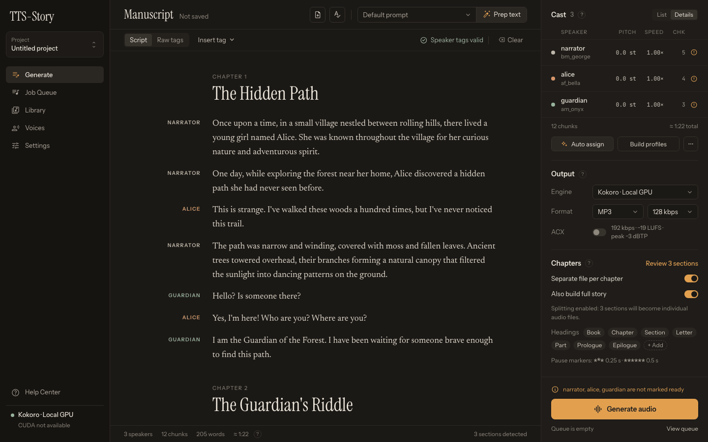

# Analyze Text and Review Statistics

TTS-Story analyzes the manuscript automatically after you stop editing. The analysis drives voice assignments, chunk estimates, and section controls; it does not generate audio or consume speech-provider quota.

## Automatic analysis behavior

Analysis normally starts shortly after typing, pasting, importing, loading a project, renaming a speaker, or completing **Prep text**. There is no separate **Analyze Text** button in the current Generate interface.

If you edit again while analysis is running, TTS-Story schedules another pass. Clicking **Generate audio** also reanalyzes when the current text differs from the last successful analysis.

For a large manuscript, wait for the footer counts and the Cast list to settle before making detailed voice selections.

## Read the footer counts

*Use the footer counts and the Cast list as a quick plausibility check before assigning voices.*

### Speakers

The number of distinct paired speaker tags. If no paired tags are present, TTS-Story displays one speaker and creates **Speaker 1**.

Check the names in the **Cast** list. Similar spellings can create accidental duplicates, such as `mary-jane` and `mary_jane`. A possible-duplicates notice below the list is advisory; inspect the manuscript before merging or renaming.

### Chunks

The approximate number of synthesis units after engine-aware text splitting. More chunks usually mean more requests, more transitions, and more opportunities for a cloud quota or local generation delay.

The final count can change with the selected engine, engine chunk size, section behavior, and edits made after analysis.

### Words

The words currently in the manuscript. Use it to catch unexpectedly empty, duplicated, truncated, or heavily rewritten imports and LLM output.

### Estimated duration (≈)

A speech-duration estimate based on the text. It is not a generation-time estimate and does not account precisely for every voice, speed setting, silence interval, expression, or later edit.

For processing-time guidance, read [Generation Time and ETA](help:generation-times).

## The Cast list and assignments

Click a speaker in the **Cast** list (or its **Review** link) to open its **Edit speaker** drawer. **Details**, at the top of the Cast list, switches to a table with each speaker's pitch, speed and chunk count. For each speaker, confirm:

- The name is correct.
- The expected passages use that tag.
- A compatible voice is selected.
- Any reference sample, language, style, or instruction is appropriate.

**Auto assign** and the **…** (Generate voices) button below the Cast list require detected tagged speakers. They are not needed for a plain-text **Speaker 1** job. See [Generate and Auto-Assign Voices](help:auto-assign-voices).

## Section detection

Analysis also checks the enabled heading terms, such as book, chapter, section, part, prologue, and epilogue. When headings are found, the footer reports *N sections detected* and the **Review N sections** link in the **Chapters** section becomes active.

Do not infer correctness from the count alone. Review the titles and boundaries before generating separate files. See [Chapters, Books, and Sections](help:chapters-and-sections).

## Warning signs

Stop and inspect the manuscript when:

- The speaker count is higher or lower than expected.
- **Speaker 1** appears even though you intended multiple voices.
- The word count differs greatly from the source.
- The chunk count jumps after selecting another engine.
- Similar speaker names appear as duplicates.
- No chapter headings are detected even though splitting is enabled.
- The tag-issue strip above the manuscript is visible.

Analysis can describe malformed or unintended text; it cannot determine whether the manuscript is editorially correct.

When the counts are plausible, continue with [Assign and Test Voices](help:assign-voices).
