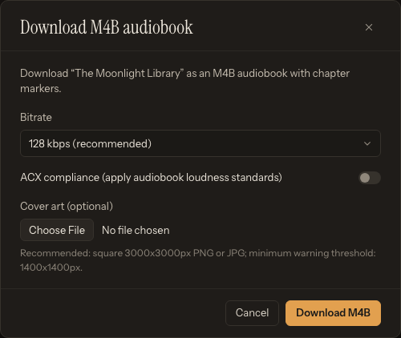

# Audiobook Exports, Metadata, and Time Codes

TTS-Story can produce a normal MP3, WAV, or OGG output during generation and can package completed chapter-mode projects as M4B audiobooks. Prepare and review the audio before making the final export.

## Normal downloads

Open [Audio Library](app:library) and use **Download ▾ → Full story** (or **Audio file**) to retrieve the normal combined output. For one chapter, use the download icon on its row or **… → Download chapter**; **Download ▾ → All chapters** downloads a ZIP.

The available normal format and bitrate were chosen on Generate when the job was submitted. Per-job generation choices override the global output defaults for that job. See [Generation and Output Options](help:generation-options).

## Edit audiobook metadata

Click **Edit metadata** (dialog *Edit audiobook metadata*) and set any applicable fields:

- Title
- Author
- Genre
- Year
- Description

These fields are saved with the Library item and shown in TTS-Story. In the current M4B exporter, the title affects the downloaded filename, while Author, Genre, Year, and Description are not embedded in the M4B. Individual chapter titles and optional cover art are embedded during export.

## Build an M4B

For chapter-mode Library items, **Download ▾ → Audiobook (M4B)** opens the **Download M4B audiobook** dialog, which provides:

*Review the export options before encoding; the final M4B is built from the current chapter audio and markers.*

- AAC bitrate choices of 64, 96, 128, or 192 kbps;
- optional ACX-oriented loudness processing;
- optional cover art; and
- progress while encoding, merging, and adding chapter markers.

The default M4B bitrate is 128 kbps. The cover selector previews the chosen image and reports its dimensions. A square PNG or JPEG around 3000 by 3000 pixels is recommended; images below 1400 pixels on either side show a resolution warning. Non-square art requires explicit confirmation and is embedded at its existing aspect ratio. TTS-Story never crops cover art automatically.

If the source job was already generated with ACX compliance, the M4B dialog disables the second ACX pass to avoid processing the audio twice.

M4B export requires FFmpeg. On Windows, setup places supported tools under the project's `tools` directory when download succeeds. If M4B creation fails, check [GPU, CPU, Model, and Dependency Errors](help:gpu-cpu-errors).

## ACX-oriented output

The Generate page's **ACX** switch selects MP3 at 192 kbps and applies the application's loudness/peak processing profile. It is a processing aid, not a publishing guarantee. Listen to the complete output and validate it with the distributor's current requirements and suitable audio-analysis tools before submission.

ACX-oriented MP3 uses 44.1 kHz mono audio and 192 kbps constant-bitrate encoding. If an older Library item was created before the CBR correction, rebuild it from retained chunks; do not apply an extra loudness pass solely to change its bitrate.

ACX processing cannot repair clipping, room noise, a poor reference recording, mispronunciation, or inconsistent performance. Fix those at chunk level first.

## Why chapter packages can run longer than Full story

**Intro silence** (Settings → Audio & generation) is applied independently to every standalone chapter file. The combined **Full story** receives that opening silence once. Because M4B export concatenates the standalone chapter files, an M4B can be longer than Full story by approximately `(chapter count - 1) × opening silence`, plus a very small AAC/container timing difference. This is expected packaging behavior and does not by itself indicate missing or duplicated narration.

For example, 22 chapters with 1.5 seconds of opening silence produce approximately 31.5 additional seconds in the chapter-file package and M4B compared with Full story.

## Generate video chapter time codes

Open the production's **…** menu and choose **Time codes** (dialog *YouTube time codes*). TTS-Story reads the saved chapter durations and calculates chapter start times.

1. Enter the length of any video intro in **Intro length** (seconds).
2. Adjust **Drift adjust** (s / chapter) if timestamps accumulate a small offset over a long video.
3. Click **Calculate**.
4. Click **Copy** and paste the result into the video description.

The initial intro is 0 seconds and the drift adjustment defaults to 0.07 seconds per chapter. The output uses `HH:MM:SS` timestamps and numbered chapter labels. Compare several timestamps against the uploaded video before publishing; video encoding or a separately added intro can shift them.

## Final-export checklist

- Regenerate every corrected chunk.
- Rebuild affected chapters and the Full story.
- Listen across chapter joins.
- Confirm the output filename, chapter titles, cover art, and the metadata saved with the Library item.
- Confirm the intended bitrate and format.
- Back up the completed Library directory before using **Clear all**.

For repair steps, see [Edit, Rebuild, and Repair Library Items](help:library-editing-repair).
