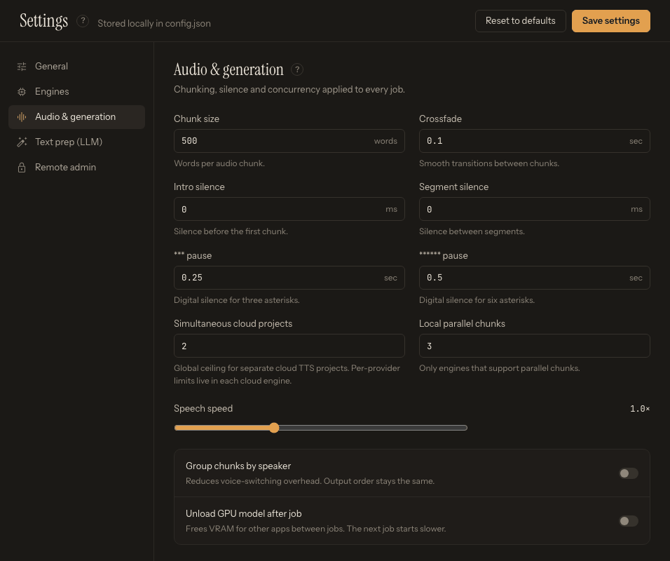

# Audio and Generation Settings

Open [Settings](app:settings) and choose **Audio & generation** in the section list for defaults shared across jobs. Engine panels also contain engine-specific chunk limits and quality controls.

*Global defaults establish a starting point, while the visible Generate options become the settings saved with the submitted job.*

## Chunk size

The shared **Chunk size** (words) defaults to 500 and is the fallback word-based text chunk size. Supported engines normally use their own character-based chunk setting instead:

- Kokoro: 500 characters
- Chatterbox Turbo Local and Replicate: 450
- VoxCPM: 550
- Pocket TTS: 450
- Qwen3: 500
- OmniVoice: 500
- KittenTTS: 300
- IndexTTS: 400
- Dot.TTS: 250
- Azure Speech: 1000
- Edge TTS: 1000
- ElevenLabs: 4000

Smaller chunks reduce memory and timeout risk but create more requests and joins. Larger chunks preserve more sentence context but can exceed engine or provider limits. Stay near each engine's displayed recommendation until a representative test succeeds.

LLM preparation chunking is separate and is configured under **Text prep (LLM)**.

## Crossfade

**Crossfade** (seconds) defaults to 0.1 seconds and smooths joins during merge. Increase it only to hide audible boundaries; too much overlap can swallow consonants or make closely spaced dialogue sound rushed.

## Silence

**Intro silence** (ms) defaults to 0 and is prepended during output assembly. Chapter files each receive their assembled intro behavior, while the combined Full story avoids repeating that intro between chapters.

**Segment silence** (ms) inserts the configured silence between synthesized chunks during output assembly. It applies at chunk joins, so test a short chapter before using a large value. For a correction needed at only one boundary, use that chunk's leading or trailing silence in Library review and rebuild the affected outputs.

## Pause markers

**\*\*\* pause** (default 0.25 s) and **\*\*\*\*\*\* pause** (default 0.5 s) set the digital silence inserted for `***` and `******` markers in the manuscript.

## Concurrency

**Local parallel chunks** (1–8, default 3) applies only to local engines that support parallel chunk generation. More workers can reduce elapsed time but also raise memory use.

**Simultaneous cloud projects** (1–4) is the global ceiling for separate cloud TTS jobs; each cloud engine panel has its own **Maximum parallel requests**. Higher values can trigger account concurrency, throttling, or cost limits.

## Group chunks by speaker

This option lets supporting batch engines reduce voice-switching overhead while preserving output order. It is most useful when a book alternates among a small number of reference voices. Test it on a chapter before relying on a performance gain.

## Speech speed

Global **Speech speed** ranges from 0.5× to 2.0× and defaults to 1.0×. Per-speaker speed on Generate can override the global value for that assignment. Large time-stretch changes may add artifacts; prefer the engine's natural performance when possible.

## Unload GPU model after job

When enabled, TTS-Story unloads cached engine state and clears available GPU memory after a completed job. This is useful when switching models or sharing the GPU with another application. The next job must load the model again, so repeated jobs with the same engine start more slowly.

## Output controls live on Generate

Default format and bitrate are in **General**, but the submitted job uses the engine, MP3/WAV/OGG selection, bitrate, ACX option, and chapter options currently shown on [Generate](app:generate).

See [Generation and Output Options](help:generation-options) and [Performance Tuning for GPU and CPU Systems](help:performance-tuning).
