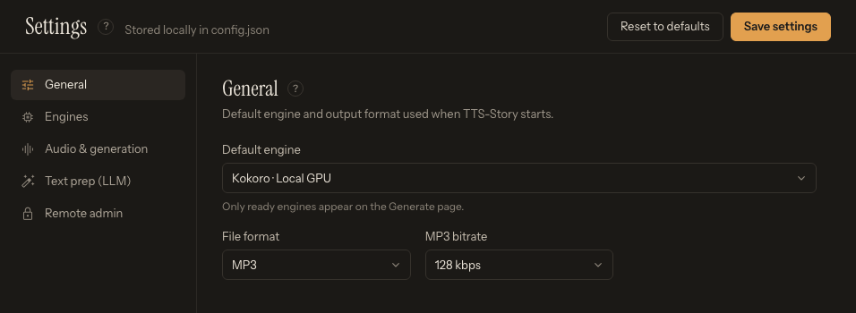

# Settings Reference

[Settings](app:settings) contains persistent defaults and provider configuration. Choices made directly on Generate are job-specific and override the corresponding default for that submitted job.

*Pick a section on the left, configure it, and click Save settings at the top right before testing.*

## General

**General** selects the default TTS engine, output format, and output bitrate. Fresh configuration defaults to:

- TTS engine: Kokoro · Local GPU
- Output format: MP3
- Output bitrate: 128 kbps

Changing the default engine also preselects it in **Engines**; open **Engines** to configure it, then click **Save settings** at the top right of the Settings screen.

## Engines

The engine list is grouped into **Local · this computer** and **Cloud · remote**. Each engine has a status dot (green *Ready*, amber *Needs setup*, grey *Not installed*), and the selected engine's panel shows a status pill (*Ready*, *Partly ready*, *Needs setup*, *Not installed*, *Working…*, *Restart required*). The legend below the list counts ready engines and links to **How engines work**. Only ready engines appear in Generate.

Each engine panel contains only the controls relevant to that integration, such as:

- model or version;
- device and numeric CUDA device;
- chunk character limit;
- default built-in voice or reference prompt;
- sampling or diffusion controls;
- cloud URL, API key, timeout, rate, or concurrency; and
- engine-specific normalization and post-processing.

Start with the displayed defaults. Follow the matching article in [Engine Reference and Comparison](help:engine-overview) before changing model-specific sampling controls.

Cloud catalog buttons such as **Test connection & load voices** (Azure Speech, Edge TTS), **Test connection & load catalog** (ElevenLabs), **Discover models** (LocalAI), and **Load models & voices** (Breeze API) validate the current fields and populate account/service choices. Save after selecting the desired default. Cloud panels also have **Save provider**, which saves all settings.

Local panels provide **Install engine**, or **Repair** and **Remove engine** once installed. Installation progress survives navigation and page refreshes, and each local runtime is isolated from the TTS-Story core and other engines. See [Install, Remove, and Reinstall TTS Engines](help:engine-management).

## Audio and generation defaults

The **Audio & generation** section contains shared chunking, crossfade, silence, `***` / `******` pause lengths, cloud-project and local parallel-chunk limits, grouping, speech speed, and GPU-cleanup controls. See [Audio and Generation Settings](help:settings-audio) for their scope and current limitations.

## Text prep (LLM)

The **Text prep (LLM)** section selects Gemini, Atlas Cloud, OpenRouter, LM Studio, or Ollama as the **Primary provider**. It stores provider URLs, model selection, tuning values, prompts, and credentials. **Backup profiles** creates an ordered fallback chain; each profile has its own name, provider, optional model override, optional API-key override, and daily request limit. Blank model/key overrides inherit the selected provider's normal settings. New profiles default to 18 requests per Pacific day; `0` means unlimited.

These settings support Prep text, Build profiles, and the individual **Build profile** action in the Edit speaker drawer; they do not select a TTS engine. Every new operation starts with the primary profile. A multi-section Prep text run remains on a successful backup for the rest of that run unless it also fails.

See [LLM Preparation Overview](help:llm-overview) and [Gemini, Atlas Cloud, and OpenRouter](help:llm-cloud).

## Save behavior

**Save settings** writes the displayed values to local `config.json`. New analysis and generation operations load those saved settings. A generation job also receives a snapshot of applicable configuration so later global changes do not silently redefine the already submitted job.

Per-job Generate controls, including engine, format, bitrate, ACX, and assignments, take precedence for that job.

Prompt preset actions save their preset changes when used; still use **Save settings** after changing provider, engine, or tuning fields.

## Reset behavior

**Reset to defaults** (Settings header) asks for confirmation and writes the reset values represented by the current Settings interface. After a reset, review the selected engine and any newer engine/LLM panels before assuming every historical value was cleared; some per-engine fields are not part of the reset payload and saved configuration is merged rather than replacing the whole file.

For a guaranteed clean migration, preserve a secure backup, compare with the current example/default configuration, and rerun setup/update as appropriate instead of deleting files blindly.

## Remote admin

**Remote admin** controls authenticated remote engine install, removal, and restart; see [Install, Remove, and Reinstall TTS Engines](help:engine-management).

## Protect credentials

Password-style fields hide keys on screen, but saved keys are plain text in `config.json`. Never post that file in an issue or commit it while populated. See [Local Data, API Keys, and Backups](help:data-storage).
