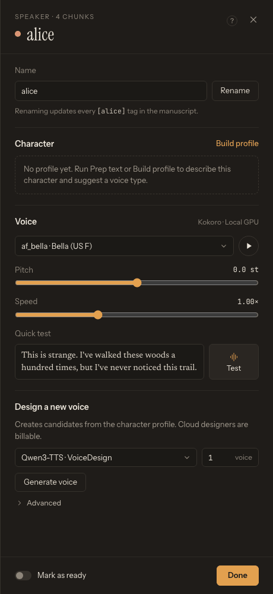

# First-Run Checklist

Use this checklist after TTS-Story has been installed and the browser interface has opened on the default **Generate** page. Keep the TTS-Story terminal or launcher running while you use the browser interface. You do not need to install or configure every engine.

## 1. Confirm that the interface is connected

At the bottom of the left sidebar, check the engine status:

- The first line, with a colored dot, shows the currently selected engine.
- **CUDA** reports whether the main environment can use an NVIDIA CUDA device (for example *CUDA not available*).

A missing CUDA device is not a general failure. CPU engines and online services do not require CUDA. If the page does not populate or both indicators remain at **Loading…** or **Checking…**, restart TTS-Story before changing settings.

## 2. Install or configure a realistic first engine

On a new installation, TTS-Story opens a welcome dialog because no speech engine is forced into the core setup. Select **Open engine settings**, or open [Settings](app:settings) and choose **Engines** in the section list. In the engine list a grey dot means *Not installed*, an amber dot *Needs setup* and a green dot *Ready*; the selected engine's panel repeats the status next to its title.

For a local engine, select it under **Local · this computer** and click **Install engine**. Keep the TTS-Story backend running while the progress log runs. You may navigate away or refresh and then return to the panel to reconnect to the current operation. Restart TTS-Story only when its panel displays the restart action. For a cloud or self-hosted engine, select it under **Cloud · remote**, enter the required endpoint, credentials, model, or region and click **Save provider** (or **Save settings** at the top right).

Local engines are installed separately under engine-owned virtual environments, so one engine's package versions do not replace another's. Read [Install, Remove, and Reinstall TTS Engines](help:engine-management) before removing or repairing an engine.

After at least one engine shows a green dot, open **General** and choose a **Default engine** suited to this computer:

- NVIDIA GPU: a local GPU engine can provide privacy and avoid usage fees.
- CPU-only computer: Pocket TTS or KittenTTS is a practical local starting point.
- Internet connection with no speech API key: **Microsoft Edge TTS · Experimental Cloud** is easy to test, but its consumer service is unofficial and not guaranteed.
- Existing cloud account: use Replicate, Azure Speech, or ElevenLabs after configuring its credentials.
- Existing LocalAI deployment: connect **LocalAI TTS** to reuse a TTS model already served by that LocalAI host.

The saved default is only the starting selection for new work. The **Engine** field in the **Output** section of the Generate page can override it for an individual job.

Only ready engines appear in the **Default engine** list and in the Generate **Engine** list. Click **Save settings** after choosing the default.

*Start in General, keep the initial audio defaults, and save a known-good baseline before tuning.*

For a full comparison, read [Choose the Right Engine](help:choose-engine).

## 3. Configure only the services you will use

Still in **Settings**:

- Open **Engines** for a speech provider.
- Open **Text prep (LLM)** only if you plan to use **Prep text**.
- Enter credentials directly into the password fields.
- Use the provider's **Test connection & load voices**, **Test connection & load catalog**, **Discover models**, **Load models & voices**, or **Fetch models** control when available.
- Click **Save settings** at the top right of the Settings screen (cloud engine panels also have **Save provider**).

Atlas Cloud, OpenRouter, and Gemini are LLM providers; they prepare text but do not generate the final audio. Azure Speech, Edge TTS, ElevenLabs, and Replicate-backed engines generate speech.

Never paste a real API key into story text, project names, screenshots, logs, or issue reports. See [Configure Online Services Safely](help:online-services).

## 4. Confirm that the required voices are available

Return to [Generate](app:generate), select the intended **Engine** in the **Output** section, and enter a short sentence. After automatic analysis, each detected speaker appears as a row in the **Cast** list.

The voice selector in the speaker's **Edit speaker** drawer changes with the engine:

- Built-in engines show their preset voices.
- Cloning engines show locally saved samples in **Voice Sample**.
- Azure Speech, Edge TTS, and ElevenLabs use catalogs loaded from their services.

If a cloud selector is empty, return to that engine's Settings panel and load its catalog again. If a cloning selector is empty, add a clean reference recording on the **Voice prompts** sub-tab of [Voices](app:voices); see [Reference Voice Prompts](help:voice-prompts).

*After analysis, open each speaker from the Cast list and check that it has a compatible voice; rows without one show No voice.*

## 5. Run a short Quick test

Click a speaker in the **Cast** list (or its **Review** link) to open the **Edit speaker** drawer, choose one voice, leave **Pitch** and **Speed** at their defaults, and click **Test** under **Quick test**. The first local preview or job can be slower because a model may be loading or downloading. When the first job is submitted with an engine, a one-time overlay explains that the job may remain quiet while its runtime prepares. A successful later preview or generation is a better measure of normal responsiveness.

If the preview fails:

1. Recheck the selected engine and voice.
2. For a cloud engine, retest credentials and confirm the account has quota.
3. For a local engine, allow any first-run model download to finish.
4. Restart after installing or updating dependencies.

Use [Troubleshooting Checklist](help:troubleshooting-overview) if the error persists.

## 6. Save a known-good baseline

Keep default audio and performance settings until a short generation completes successfully. Then change one setting at a time. For important work, save the current Generate-page state in **Projects** (click the **Project** switcher at the top of the left sidebar). Projects are stored by the TTS-Story backend and remain consistent across `localhost`, `127.0.0.1`, and local-network URLs that reach the same installation. They are still not a substitute for backing up the original manuscript or the TTS-Story data folders.

You are ready for [Generate Your First Audio](help:quick-start).
