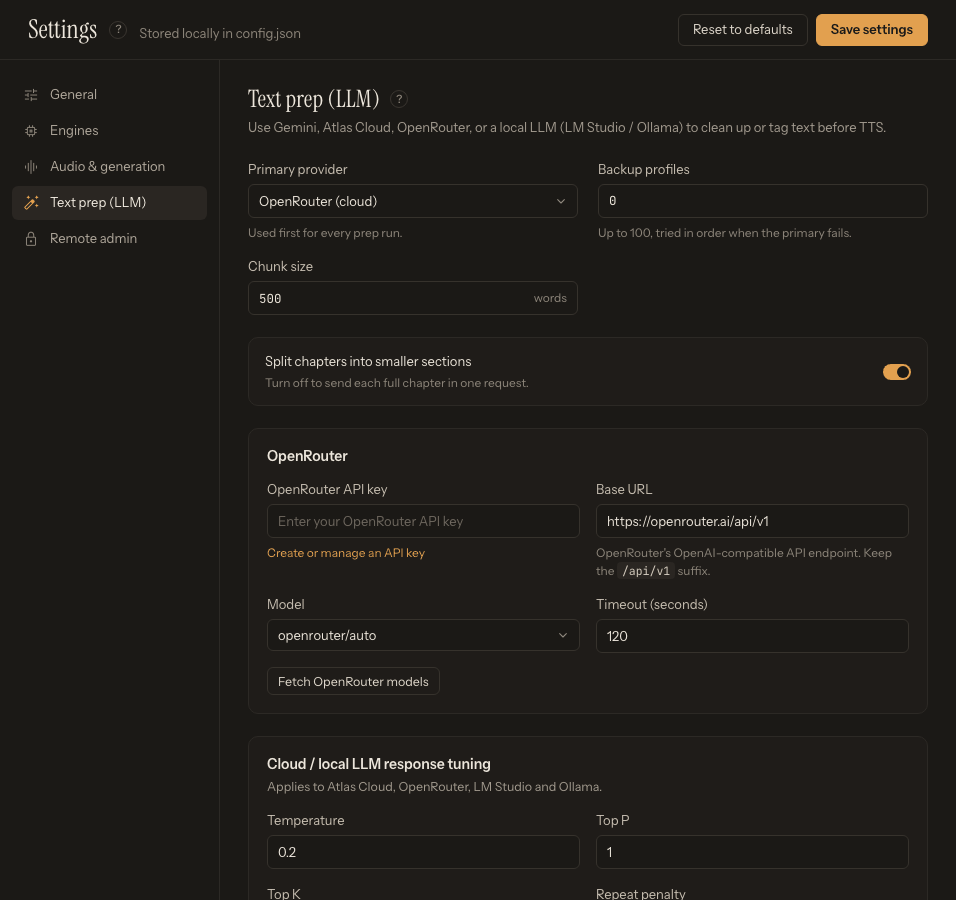

# Configure Online Services Safely

Online services are optional. Configure only the speech and LLM providers you intend to use, and understand which content each one receives.

Open [Settings](app:settings) to manage credentials.

## Speech providers and LLM providers are different

**Speech providers** receive text and return audio:

- Replicate-backed Kokoro or Chatterbox
- Microsoft Azure AI Speech
- Microsoft Edge TTS (no API key, experimental consumer service)
- ElevenLabs
- OpenAI-compatible TTS
- LocalAI TTS (self-hosted or remotely hosted)

**LLM providers** receive manuscript text and return prepared text:

- Gemini
- Atlas Cloud
- OpenRouter

LM Studio and Ollama are supported local LLM options. Selecting an LLM provider does not select the TTS engine, and selecting a cloud TTS engine does not require using **Prep text**.

LocalAI TTS is also separate from local LLM preparation. It connects the speech-generation workflow to a running LocalAI server and does not use LM Studio or Ollama to synthesize audio.

## Safe setup procedure

1. Create the provider account and key on the provider's official site.
2. Review pricing, quota, retention, and data-use terms before uploading a long or sensitive manuscript.
3. In TTS-Story, open the matching panel under **Settings → Engines** or the **Text prep (LLM)** section.
4. Paste the key only into its password field.
5. Keep the default base URL unless the provider or this guide specifically requires another endpoint.
6. Use **Test connection & load voices**, **Test connection & load catalog**, **Discover models**, **Fetch models**, or the equivalent control.
7. Choose a returned voice or model.
8. Click **Save provider** in the engine panel, or **Save settings** at the top right of Settings.
9. Run a short preview or preparation sample before a full book.

## What is stored locally

Saved provider credentials are written to the local TTS-Story configuration. They are not part of a browser project snapshot, but anyone with access to that configuration—or to an exposed, unsecured application instance—may be able to use them.

- Do not commit a populated `config.json` to a public repository.
- Do not include credentials in screenshots or copied diagnostic responses.
- Do not paste a key into the manuscript, an LLM prompt preset, a project name, or a GitHub issue.
- Revoke and replace a key immediately if it may have been exposed.
- Prefer provider keys with the narrowest permissions and spending limits that still work.

See [Local Data, API Keys, and Backups](help:data-storage) for storage details.

## Cost and quota controls

TTS-Story cannot guarantee that a provider request is free. Before a large job:

- Confirm the selected account, project, or subscription.
- Check remaining characters, credits, or billing limits.
- Start with low parallelism where the provider enforces concurrency limits.
- Estimate the manuscript size from the word and chunk counts under the manuscript.
- Watch the first several requests in **Job Queue**.

HTTP `401` or `403` usually indicates authentication or permission trouble. `402` commonly indicates billing or exhausted allowance. `429` means rate or concurrency throttling. Timeouts and `5xx` responses can be temporary provider or network problems. See [Cloud Credentials, Quota, and Network Errors](help:cloud-errors).

## Provider-specific checks

### Replicate

Enter the Replicate API token under **Settings → Engines → Kokoro Cloud** or **Settings → Engines → Chatterbox Cloud**. The token and maximum parallel-request setting are shared between those two Replicate engines, while their model and generation controls remain engine-specific.

### Azure Speech

The **Speech resource key** and **Region** must belong to the same Azure Speech resource. Enter the short region name, then use **Test connection & load voices**. Available styles and roles vary by voice. See [Microsoft Azure AI Speech](help:engine-azure-speech).

### Edge TTS

No key is required. Use **Test connection & load voices** to retrieve the current catalog. Because the service boundary is unofficial, availability and throttling can change. See [Microsoft Edge TTS (Experimental)](help:engine-edge-tts).

### ElevenLabs

Enter the account API key and choose **Test connection & load catalog**. TTS-Story loads the voices and models permitted for that key and may show character usage when the key can access subscription information. See [ElevenLabs](help:engine-elevenlabs).

### LocalAI TTS

Start the LocalAI server and its TTS model first. Under **Settings → Engines → LocalAI TTS**, enter the reachable `/v1` address in **LocalAI base URL**, add a key only when that server requires one, and click **Discover models**. TTS-Story discovers speech-capable models and saved voice profiles rather than installing a second runtime. Transcript-ready TTS-Story prompts can also be offered when the selected model advertises compatible voice cloning. See [LocalAI TTS](help:engine-localai-tts).

### Gemini, Atlas Cloud, and OpenRouter

Select the provider as **Primary provider** under **Settings → Text prep (LLM)**, enter its key, and use the matching model-fetch button. Model lists depend on the provider and the permissions or preferences associated with the key. See [Gemini, Atlas Cloud, and OpenRouter](help:llm-cloud).

*Choose the cloud LLM provider, enter its key privately, fetch the permitted models, and save the selected model.*

## Protect the manuscript too

Credentials are not the only sensitive data. A cloud speech provider receives the chunks it synthesizes; a cloud LLM receives the portions sent through **Prep text**; a cloning service may also receive reference audio. Use local alternatives for material that must not leave the computer.

After configuration, return to [Generate](app:generate) and follow [Generate Your First Audio](help:quick-start).
