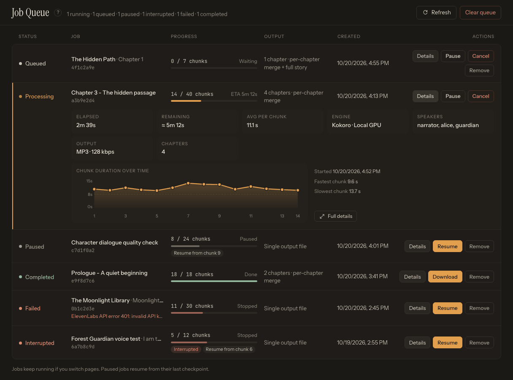

# Generate Your First Audio

This walkthrough creates a short, reviewable job with the fewest moving parts. Complete the [First-Run Checklist](help:first-run) first if you have not yet selected a working engine.

## 1. Start with a small passage

Open [Generate](app:generate). Paste two or three paragraphs into the **Manuscript** editor (in the **Raw tags** view), or use this example:

```text
[narrator]Rain tapped softly against the library windows.[/narrator]
[maya]Did you hear that?[/maya]
[narrator]Maya turned toward the old wooden door.[/narrator]
```

Plain text is also valid. With no speaker tags, TTS-Story creates a single assignment named **Speaker 1**.

Once the text contains speaker tags, you can choose **Script** in the manuscript toolbar to read it as a script, one paragraph per speaker. Script is read-only; choose **Raw tags** to edit again. Typing or pasting never switches the view for you, but tagged text opens in Script when you reload the page, load a project, or import a document into an empty manuscript (unless you last chose **Raw tags** yourself).


*Begin on Generate with a short representative passage before committing a full manuscript.*

Keep an untouched source copy outside the app. **Load document** (the upload icon in the Manuscript header) appends imported content to anything already in the manuscript, and **Prep text** replaces the whole manuscript with LLM output.

## 2. Wait for automatic analysis

After you stop typing, TTS-Story analyzes the text automatically. The footer under the manuscript shows the number of **speakers**, **chunks** and **words** and the estimated duration (**≈ m:ss**), and every speaker appears in the **Cast** list.

There is no separate analysis button in the current Generate page. Editing, pasting, importing, loading a project, or completing **Prep text** triggers analysis; **Generate audio** also reanalyzes stale text before submission.

If a tag warning appears above the manuscript, use the up and down arrow buttons (*Previous issue* / *Next issue*) to inspect each problem. **Auto-fix** can insert missing tags, but always read the affected text afterward. Audio generation is blocked while unmatched speaker tags remain. See [Speaker and Expression Tags](help:speaker-tags).

## 3. Select the job engine first

In the **Output** section of the right-hand column, choose **Engine**. Do this before selecting voices because changing engines changes the available voice controls and may invalidate an earlier choice.

The job-level selection can differ from the saved default in Settings. If you are unsure, see [Choose the Right Engine](help:choose-engine).

## 4. Assign every speaker

In the **Cast** list, click each speaker (or its **Review** link) to open the **Edit speaker** drawer and select a voice or **Voice Sample**. An assignment is required even for plain text and **Speaker 1**.

For the first test:

- Leave **Pitch** at `0.0 st`.
- Leave **Speed** at `1.00×`.
- Click **Test** under **Quick test** for each important speaker.
- Verify that a cloned voice uses the intended reference recording.

Cloud engines may offer additional controls such as Azure speaking style or ElevenLabs voice settings. Defaults are appropriate for this first run. See [Assign and Test Voices](help:assign-voices).

## 5. Choose simple output options

For a short test:

- Choose **MP3** for a compact, convenient file or **WAV** for an uncompressed review file.
- Leave the **ACX** switch in **Output** off until you are preparing a publication export.
- If your sample has no real chapter headings, turn off **Separate file per chapter** in the **Chapters** section.

See [Generation and Output Options](help:generation-options) for the full behavior.

## 6. Submit the job

Click **Generate audio** at the bottom of the right-hand column. Before queuing, TTS-Story will:

1. Confirm there is text.
2. Reanalyze it if necessary.
3. Stop on unmatched speaker tags.
4. Require at least one valid voice assignment.
5. Include any active Alternate Word Registry entries and per-job options.

On success, a notification reports that the job was queued and TTS-Story opens [Job Queue](app:queue) with the new job's details expanded. You can return to Generate and keep preparing other work while it runs.

## 7. Monitor and review

Watch status and progress in [Job Queue](app:queue). A first local job may spend extra time loading or downloading a model. Cloud timing depends on the provider, quota, network, and number of chunks.



*Use Job Queue to watch progress and open Details when a job pauses or fails.*

When the job completes, open [Library](app:library). Play the result from beginning to end and note:

- Mispronounced words
- Voice assignments that do not fit
- Pace or pitch that needs adjustment
- Awkward chunk transitions
- Incorrect chapter boundaries

Use chunk review and regeneration for isolated problems instead of rerunning the entire story. See [Review and Regenerate Chunks](help:job-review).

## If the first job will not submit

- **Assign voices...**: every detected speaker, including Speaker 1, needs a selection.
- **Unmatched speaker tags**: correct the tag warning above the manuscript.
- Empty cloud voice list: reload the catalog in [Settings](app:settings).
- Preview works but generation fails: inspect [Job Queue](app:queue) for the job error and see [Troubleshooting Checklist](help:troubleshooting-overview).

Next, learn the complete flow in [How the Pages Work Together](help:workflow-map).
