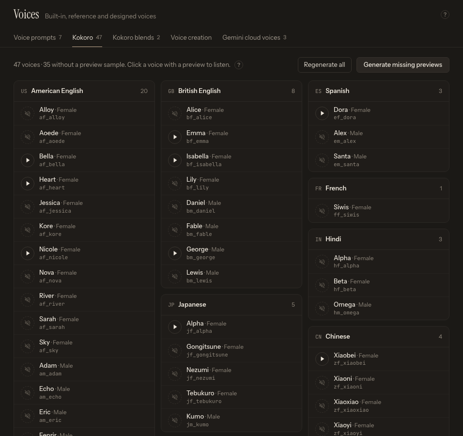

# Kokoro Voices and Previews

Kokoro includes built-in voices grouped by language. Open [Voices](app:voices/kokoro) and select the **Kokoro** sub-tab to browse them. Each language has its own card listing its voices with their gender and voice code.

*Browse the catalog by language, then generate and compare previews before assigning a voice to a speaker.*

## Choose the correct language group

Kokoro voice groups use these language codes:

- `a` — American English
- `b` — British English
- `e` — Spanish
- `f` — French
- `h` — Hindi
- `j` — Japanese
- `z` — Mandarin Chinese
- `p` — Brazilian Portuguese

Choose a voice from the same language group as the text. A voice can sometimes produce sounds for another language, but pronunciation and rhythm are not guaranteed.

## Generate and play previews

The status line at the top of the Kokoro sub-tab shows how many voices still lack a preview sample. **Generate missing previews** creates samples only for those voices; **Regenerate all** deliberately overwrites every existing preview. Preview generation loads the local Kokoro engine and can take longer on the first run.

Click a voice's play button to hear its preview and click it again to stop. Voices without a preview show a muted speaker icon instead. An **In use** pill marks voices that are currently assigned to a speaker on Generate.

Use the same short test sentence when comparing several voices. Include one proper name, a number, and representative punctuation from the manuscript. A catalog preview is useful for tone, but **Quick test** in the speaker's **Edit speaker** drawer is more representative because it uses the job's current text and voice settings.

## Assign a voice

1. Open [Generate](app:generate).
2. Select **Kokoro · Local GPU** or **Kokoro · Replicate** as the **Engine** in the **Output** section.
3. Let the manuscript be analyzed.
4. Click the speaker in the **Cast** list.
5. Choose the voice in **Voice** (the code prefix shows its language, for example `bf_` = British English female).
6. Click **Test** under **Quick test** before generating the full job.

The Local and Replicate engines share the voice concept, but Replicate sends generation requests to an online service and requires a configured token. Review [Kokoro: Local and Replicate](help:engine-kokoro) for engine setup.

## Improve a voice without cloning

If no single Kokoro voice fits, create a reusable weighted blend from voices in the same language. A blend remains a Kokoro voice and does not need reference audio. See [Custom Kokoro Voice Blends](help:custom-kokoro-blends).

Pitch and speed effects can change perceived age or delivery, but large changes can introduce artifacts. Start with the unmodified voice and make restrained adjustments in the speaker's Edit speaker drawer. See [Assign and Test Voices](help:assign-voices).
